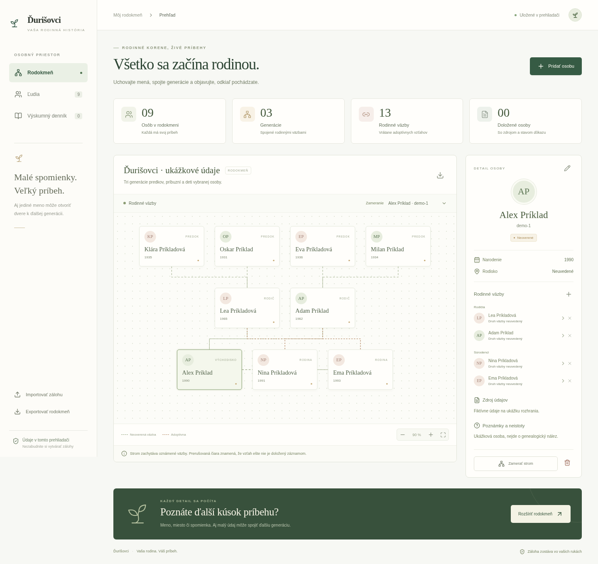

# Ďurišovci

`zpoledomu` je názov repozitára, **Ďurišovci** je názov rodokmeňa.

[Výsledky výskumu z 13. 10. 2026](docs/vyskum-vazby-2026-10-13.md): sčítanie 1930 uvádza matku a troch súrodencov Jozefa Kulicha (18. 10. 1919). Aktuálna rodina má 31 osôb a 51 vzťahov, vrátane potvrdených väzieb tetám. [Živý rodokmeň](https://durisovci.vercel.app/).

Otcova línia je naľavo, maminkina napravo. Každá generácia má spoločný riadok: rodičia s tetami a strýkami, Peter so sestrami a bratrancami/sesternicami, pod nimi ďalšia generácia. Páry sú vedľa seba; deti spája iba línia ich zaznamenaných rodičov. Tlačidlo **Celý strom** otvorí veľký prehľad. Detail osoby sa otvára po kliknutí na kartu.

[Nové hľadanie a oprava Pavla](docs/vyskum-rodiny-2026-10-13.md): Pavel je syn Ruženy a Pavla z otcovej vetvy; doplnených šesť potvrdených priezvisk. Sedem nových dotazov cintorínskych indexov zatiaľ neprinieslo ďalšiu doloženú väzbu.

[Manželia a deti](docs/manzelia-a-deti.md): doplnené rodiny tetiek, Marianny a Denisy aj Sylvia Offei Kwatya; manželia sú vedľa seba a strom zobrazuje aj deti príbuzných. Ďalšie deti tetiek zostávajú otvoreným výskumom.

## Otvorenie bez inštalácie

V repozitári otvorte `index.html`, použite **Download raw file** a stiahnutý súbor otvorte v prehliadači. Tento súbor už obsahuje celý JavaScript aj štýly; nepotrebuje server. Na požiadanie používateľa predvolená verzia obsahuje 31 členov rodiny Ďurišovcov a oznámené či výskumom podložené vzťahy. Narodenia žijúcich alebo osôb bez doloženého úmrtia sú vo verejnom nasadení iba v rozsahu roku. Šesť identifikovaných zosnulých má dátumy podložené cintorínskymi záznamami a náhrobkami; súkromné presné narodenia živých a výskumný archív zostávajú mimo repozitára. Rodinné podanie je označené ako NEOVERENÉ, podložené závery majú citované zdroje.



## Produkcia na Verceli

`vercel.json` nastavuje framework Vite, build `npm run build` a výstup `dist`. Pri pripojenom GitHub repozitári sa push do produkčnej vetvy použije na nový deployment. Počiatočná rodina je vložená do klientského balíka a nevyžaduje `/api/family`; neprítomnosť vývojového servera preto nevytvorí prázdny rodokmeň. Kód na GitHube, vytvorený build a živý deployment treba overovať oddelene.

## Alternatíva: GitHub Pages

1. Otvorte [Settings → Pages](https://github.com/pierresk1611/zpoledomu/settings/pages).
2. V **Build and deployment** nastavte **Source: Deploy from a branch**.
3. Vyberte vetvu **main** a priečinok **/(root)**, potom **Save**.
4. Po úspešnom nasadení sa aplikácia zobrazí na `https://pierresk1611.github.io/zpoledomu/`. Adresa nie je aktívna len tým, že je kód v repozitári; musí byť zapnuté Pages a dokončené nasadenie.

Po zmenách zdrojov obnovte samostatný súbor príkazom `npm run release` a commitnite aktualizovaný `index.html`. Vývojový vstup je `dev.html`; hotový `index.html` je určený na otvorenie bez servera a na GitHub Pages.

Slovenská aplikácia na rodokmeň a genealogický výskum. Zobrazuje predkov a príbuzných vybranej osoby, eviduje rodičovské, partnerské a súrodenecké väzby, rozlišuje adopciu, uchováva zdroje a neistoty. Podporuje pridávanie a úpravy osôb, hľadanie, export a kontrolovaný import JSON záloh.

## Spustenie

Vyžaduje Node.js 22 alebo novší. V tomto prostredí je overený Node.js 24.

```sh
cd /workspace/zpoledomu
npm ci --cache /workspace/.npm-cache --no-audit --no-fund
npm run dev -- --port 3000 --strictPort
```

Predvolená verzia načíta dodaných 31 osôb aj bez dátového servera. Starší prázdny zápis v prehliadači sa pri prvom načítaní doplní; existujúce osoby a úpravy zostanú zachované. Nové výskumné vydanie pridáva výslovne uvedené nové osoby a väzby aj do existujúceho rodokmeňa, pričom neprepisuje úpravy ani neobnovuje vymazané osoby zo starších vydaní. Po neskoršom úmyselnom odstránení osôb sa rodina automaticky neobnovuje. Zálohu možno importovať vo webovom rozhraní. Voliteľný lokálny súbor načíta vývojový server pri prvom otvorení v prehliadači:

```sh
GENEALOGY_DATA_FILE=/workspace/genealogia-private/rodokmen.json npm run dev -- --port 3000 --strictPort
```

Rodinné údaje sú uložené mimo Git repozitára. Premenná obsahuje len lokálnu cestu; súkromné doklady a presné dátumy nevkladajte do zdrojových súborov. Verejné počiatočné profily v `src/initial-family.json` sú publikované na výslovné požiadanie používateľa. Vývojový server poskytuje tento voliteľný súbor cez `/api/family` iba v režime `dev`. Aplikácia nemá prihlasovanie; prístup k vývojovému serveru preto patrí iba oprávneným používateľom. Verejné nasadenie s rodinnými údajmi vyžaduje samostatné riešenie prístupu.

Zmeny sa ukladajú do `localStorage` daného prehliadača a pôvodu. Nejde o synchronizáciu s pôvodným súborom ani medzi zariadeniami. Exportujte zálohy, najmä pred zmenou prehliadača, importom alebo vymazaním údajov. Poškodené uložené údaje sa neprepisujú automaticky; obnovenie je možné importom platnej zálohy.

Produkčný build obsahuje predvolené profily zo `src/initial-family.json`, ale neobsahuje súkromný vstupný súbor ani dátový server. V prehliadači je možné importovať vlastnú JSON zálohu.

## Samostatný HTML rodokmeň

Statický náhľad samotného vývojového `dev.html` nevie spracovať JSX ani načítať balíky. Pre takýto náhľad alebo otvorenie na vlastnom počítači vytvorte jeden HTML súbor so všetkým JavaScriptom, štýlmi a voliteľnými rodinnými údajmi:

```sh
npm run standalone -- --data /workspace/genealogia-private/rodokmen.json --out /workspace/genealogia-private/rodokmen.html
python3 tests/standalone_smoke.py /workspace/genealogia-private/rodokmen.html
```

Súbor nepotrebuje Vite, API ani internet na zobrazenie rodokmeňa. Výstup s podrobným súkromným vstupom musí zostať mimo Git repozitára; verejný index používa iba predvolené profily určené používateľom na publikovanie. Možno ho stiahnuť a otvoriť v bežnom prehliadači; cloudový testovací Chromium blokuje priame `file:` adresy, preto sa kontroluje cez dočasný server poskytujúci iba tento dokument. Test zahŕňa aj izolovaný rámec bez prístupu k úložisku.

V izolovanom náhľade môže byť ukladanie prehliadača zakázané. Aplikácia to označí a umožní úpravy v pamäti; pred zatvorením použite export. Po aktualizácii výskumného vstupu HTML znovu vygenerujte. Existujúce úpravy prehliadača sa tým nesynchronizujú ani automaticky nenahrádzajú.

## Kontroly

```sh
npm test
npm run build
python3 tests/browser_smoke.py
python3 tests/generation_layout_smoke.py
```

Jednotkové testy kontrolujú rodinné väzby, cykly v pôvode, adopcie, dátumy, citácie, import a odstraňovanie. Test prehliadača vyžaduje bežiaci server na porte 3000, Python Playwright a Chromium, ktoré sú v tomto cloudovom prostredí dostupné. Používa izolovaný prehliadač a fiktívne dáta; skutočný rodinný súbor nemení. Test `generation_layout_smoke.py` navyše kontroluje generačné riadky, oddelené vetvy, susediace páry a rodičovské spojnice predvolenej verejnej rodiny bez jej úprav. Voliteľne nastavte `TEST_BASE_URL` a `CHROMIUM_PATH`.

## Výskum a dôkazy

Rodinné podanie sa zaznamenáva ako **NEOVERENÉ**. Doložený údaj alebo záver vyžaduje zdroj; neisté priezviská, rodiská a roky patria do poznámok. Adoptívne väzby sa neprepisujú na biologické. Rovnomenné osoby majú rozdielne ID. Informačná stránka archívu nevytvára dôkaz o konkrétnej osobe.

Súkromný výskumný záznam, história opráv, denník a získané podklady sú v `/workspace/genealogia-private`, mimo checkoutu. Na ďalšie pátranie treba konkrétne miesto, obdobie a podľa prameňa vierovyznanie. Prístup k živým matrikám a archívnym snímkam sa riadi podmienkami ich správcov.

Aktuálne výsledky hľadania otcových rodičov a hranice prehľadaných zdrojov: [výskumná správa](docs/vyskum-otcovi-rodicia.md).
